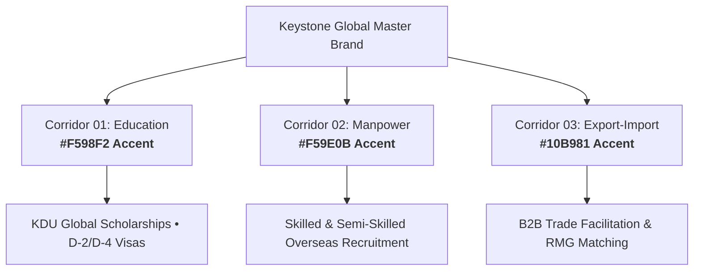

# 📘 KEYSTONE GLOBAL — OFFICIAL BRAND GUIDELINES (2026)
> **Version 2.0 (Master Identity Release)**  
> **Brand Owner:** Keystone Global (formerly Keystone Education & Manpower Consultancy)  
> **Managing Director:** Hasibul Munim (9 Years South Korea Residency & Global Mobility Specialist)  
> **Live Web Platform:** [keystone-website-main.vercel.app](https://keystone-website-main.vercel.app)

---

## 1. Executive Brand Identity & Purpose

**Keystone Global** is Bangladesh's premier cross-border opportunities agency, specializing in **South Korea Higher Education (D-2/D-4)**, **Overseas Skilled & Semi-Skilled Manpower Placement**, and **B2B International Trade Facilitation**.

### The Core Keystone Value Proposition
- **100% "No Visa, No Fee" Post-Visa Guarantee:** Students pay a **৳120,000 flat processing fee** ONLY after visa approval. Zero advance payment.
- **Institutional Legitimacy & Ground Presence:** Physical offices in Gazipur and Narsingdi, backed by Hasibul Munim's 9 years of South Korean academic and corporate residency.
- **Global University Partnerships:** Official scholarship tie-ups with KDU Global (Kyungdong University) with tuition fee waivers up to 70%.

---

## 2. Logo Architecture & Anatomy

The Keystone Global brandmark is engineered as a high-trust, dynamic horizontal lockup:

```
+-----------------------------------------------------------------------------------+
|  [ K e y s t ]       [ (RED SQUIRCLE GLOBE) ]       [ n e ]                       |
|           \___                                                                    |
|               \_____                                                              |
|                     [ / / / / /   G L O B A L   / / / / / ]                       |
+-----------------------------------------------------------------------------------+
```

1. **Wordmark:** Heavy sans-serif typography set in Deep Corporate Navy (`#0C4079`). The letter **`y`** features an extended, angled descender that anchors the lower quadrant.
2. **Central Glyph (The 'O'):** A rounded squircle in vibrant **Coral Crimson (`#EA333F`)**, containing a white 3D wireframe globe with latitude and longitude grid lines.
3. **Sub-brand Banner:** A dark charcoal parallelogram angled at -12° anchoring the bottom-right quadrant, containing **`GLOBAL`** set in bold, italicized uppercase with wide tracking (+0.28em).

---

## 3. Logo Variations & Usage Matrix

| Variant | Purpose & Environment | File Name |
| :--- | :--- | :--- |
| **Primary Light** | Standard official use on white and light neutral backgrounds. | `assets/keystone-global-logo-light.svg` |
| **Inverted Dark** | Use on navy (`#072448`), slate (`#0A0F1D`), or dark mode interfaces. | `assets/keystone-global-logo-dark.svg` |
| **App Icon / Favicon** | App icons, profile avatars, browser tabs, and favicon packages. | `assets/keystone-global-icon.svg` |
| **Monochrome Navy** | Single-tone corporate documents, official letterheads, and ink prints. | `assets/keystone-global-monochrome-navy.svg` |
| **Monochrome White** | Stamping on solid dark packaging, merchandise, and embossed materials. | `assets/keystone-global-monochrome-white.svg` |

---

## 4. Clear Space & Minimum Sizing Rules

### Clear Space (`X`)
- The mandatory clear space boundary around the logo is defined as **`X = height of the Red Squircle Globe`**.
- No typography, graphics, photos, or page borders may encroach within the `X` clearance margin.

### Minimum Reproducible Sizing
- **Digital Display:** Minimum width of **160 px** (for the full lockup) or **24 px** (for the standalone globe icon).
- **Print Collateral:** Minimum width of **35 mm (1.38 inches)** for full lockup to preserve legibility of the wireframe globe.

---

## 5. Official Color Palette & Accessibility

### Primary Brand Palette
- **Keystone Deep Navy:** `#0C4079` | RGB: `12, 64, 121` | HSL: `211°, 82%, 26%`  
  *Role:* Primary brand tone, header typography, institutional trust. WCAG AAA compliant against white.
- **Global Coral Crimson:** `#EA333F` | RGB: `234, 51, 63` | HSL: `356°, 81%, 56%`  
  *Role:* Central globe emblem, high-conversion CTAs, attention anchors.
- **Badge Charcoal Slate:** `#202020` | RGB: `32, 32, 32` | HSL: `0°, 0%, 13%`  
  *Role:* Sub-brand background, tech contrast, dark-mode body text.
- **Pure White:** `#FFFFFF` | RGB: `255, 255, 255` | HSL: `0°, 0%, 100%`  
  *Role:* Clean whitespace, wireframe globe grid, crisp typography.

### 3-Corridor Sub-Brand Accents
- **Corridor 01 — Education Sector:** `#F598F2` (Vibrant Magenta Pink)
- **Corridor 02 — Manpower Recruitment:** `#F59E0B` (Amber Gold)
- **Corridor 03 — Export-Import Trade:** `#10B981` (Emerald Green)

---

## 6. Standardized Typography System

### 1. Display & Headline Typography: **Figtree**
- **Weights:** ExtraBold (800), Bold (700), SemiBold (600)
- **Use Cases:** Website Hero titles, large marketing headlines, section badges.
- **Pairing Rationale:** Modern geometric clarity that perfectly matches spring physics UI.

### 2. Body & Formal Documentation: **Inter** / **Plus Jakarta Sans**
- **Weights:** Regular (400), Medium (500), SemiBold (600)
- **Use Cases:** Body paragraphs, university guidelines, legal contracts, CRM interfaces.

### 3. Code & Technical Monospace: **JetBrains Mono**
- **Weights:** Regular (400), Medium (500)
- **Use Cases:** Live clock displays (`CUP 24:00:00`), transaction hashes, passport numbers.

---

## 7. Multi-Corridor Brand Architecture



---

## 8. Brand Misuse & Do's / Don'ts

### ❌ Strict Prohibitions
- **DO NOT** alter the aspect ratio or stretch the logo horizontally/vertically.
- **DO NOT** rotate the logo or place the `GLOBAL` badge in unapproved positions.
- **DO NOT** replace the coral red globe with unauthorized gradients or colors.
- **DO NOT** place the Navy light logo over low-contrast dark backgrounds without switching to the dark inverted variant.
- **DO NOT** recreate the globe wireframe manually; always utilize verified SVG source files.

### ✅ Approved Best Practices
- **DO** maintain the 1X clear space margin around all asset deployments.
- **DO** use the standalone icon for mobile favicons and app dock shortcuts.
- **DO** apply the correct corridor accent color when producing sector-specific marketing brochures.

---

## 9. Asset Directory Reference

```
scratch/keystone-brand-kit/
├── assets/
│   ├── keystone-global-logo-light.svg
│   ├── keystone-global-logo-dark.svg
│   ├── keystone-global-icon.svg
│   ├── keystone-global-monochrome-navy.svg
│   ├── keystone-global-monochrome-white.svg
│   ├── keystone-global-logo-light.png
│   ├── keystone-global-icon.png
│   └── favicons/
│       ├── favicon.ico
│       ├── favicon-16x16.png
│       ├── favicon-32x32.png
│       ├── apple-touch-icon.png
│       ├── android-chrome-192x192.png
│       └── android-chrome-512x512.png
├── tokens/
│   ├── tokens.json
│   ├── tokens.css
│   ├── tailwind.tokens.js
│   └── brand-tokens.ts
├── templates/
│   ├── facebook-cover.svg
│   ├── linkedin-banner.svg
│   ├── business-card-front.svg
│   └── business-card-back.svg
├── KEYSTONE_GLOBAL_BRAND_GUIDELINES.md
└── index.html  <-- (Interactive Visual Brand Studio)
```
